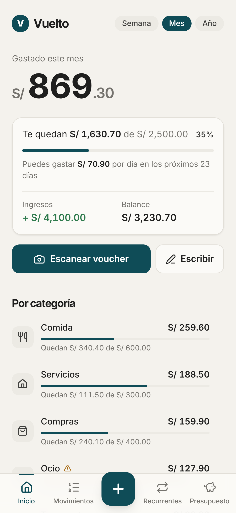
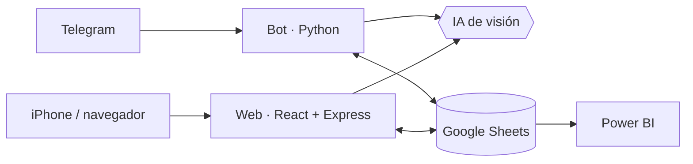

# Vuelto — caso de estudio de producto

**Asistente de finanzas personales que registra gastos a partir de la foto del comprobante.**
Bot de Telegram + app web instalable en iPhone, sobre una misma hoja de Google Sheets conectada a Power BI.

> 🔒 **El código fuente es privado**: Vuelto es una herramienta que uso a diario con mis datos financieros reales.
> Este repositorio documenta **cómo se gestionó el producto**: visión, backlog, sprints, decisiones técnicas y arquitectura.
> Puedo mostrar el código en una entrevista compartiendo pantalla.

<!-- Capturas con datos ficticios: ver capturas/LEEME.md -->
<!--   -->

---

## Mi rol
**Product Owner.** Definí la visión, escribí y prioricé el backlog, acepté cada incremento y tomé las decisiones de producto.
El desarrollo lo hice con asistencia de IA (Claude) actuando como equipo de desarrollo, bajo un flujo de trabajo
propio: una tarea por iteración, Definición de Hecho y registro de decisiones técnicas.

## El problema
Anotar gastos a mano es la razón principal por la que se abandona el control de finanzas personales. Las apps
que lo automatizan suelen pedir acceso al banco. En Perú, además, los pagos se reparten entre POS, Yape, Plin y transferencias,
cada uno con un comprobante distinto.

## La solución
Tomar foto → confirmar. Un modelo de visión lee monto, comercio, fecha, categoría y medio de pago de cualquier comprobante
peruano; el usuario confirma o corrige antes de guardar; los datos quedan tipados en Google Sheets, listos para Power BI.

| Bot de Telegram | App web |
|-----------------|---------|
| Foto o texto (`12.50 taxi`) → tarjeta de confirmación con botones | Inicio con total por semana/mes/año y barras por categoría |
| Correcciones por texto (`monto 35.50`, `fecha 23/10`) | Registro por foto, texto o voz; edición y división de movimientos |
| `/resumen`, `/ultimos`, `/deshacer`, `/hoja` | Presupuestos, topes con alertas al 80 %/100 %, recurrentes |
| Privado por lista de usuarios | Login con contraseña; se instala en el iPhone |

## Cómo se construyó: Scrum
| Sprint | Fechas | Objetivo | Versión |
|--------|--------|----------|---------|
| [1](docs/sprints/sprint-01.md) | 24 oct 2026 | MVP: registrar un gasto desde una foto en Telegram | v0.1.0 |
| [2](docs/sprints/sprint-02.md) | 25 oct 2026 | Vuelto disponible 24/7 en la nube | v0.2.0 |
| [3](docs/sprints/sprint-03.md) | 6–7 nov 2026 | App web conectada a la misma hoja | v0.3.0 |
| [4](docs/sprints/sprint-04.md) | 7 nov 2026 | Ingresos en la web | v0.4.0 |
| [5](docs/sprint_actual.md) | 8–21 nov 2026 | Profesionalización: seguridad, tests, CI | v1.0.0 (en curso) |

- 📋 [Product Backlog](docs/product_backlog.md) — visión, épicas, historias de usuario con criterios de aceptación y deuda técnica
- 🔁 [Historial de sprints](docs/sprints/) — objetivo, incremento, evidencia y retrospectiva de cada sprint
- 🧭 [Decisiones técnicas (ADR)](docs/decisiones/) — por qué Telegram, Google Sheets, Gemini, Railway, web en vez de app nativa
- ✅ [Definición de Hecho](docs/definicion_de_hecho.md) · 📝 [CHANGELOG](CHANGELOG.md)

> Los Sprints 1–4 se hicieron en iteraciones cortas y se documentaron en formato Scrum de forma retroactiva, a partir del
> código y del historial de cambios. Desde el Sprint 5 el producto se planifica y ejecuta con Scrum desde el inicio.

## Arquitectura

**Stack:** Python 3.12 · python-telegram-bot · React 19 · Vite · Tailwind CSS · Express · Google Sheets API · Gemini API · Docker · Railway · Power BI
Detalle en [`docs/arquitectura.md`](docs/arquitectura.md).

## Decisiones de producto destacadas
- **Telegram antes que una app propia**: validar la lectura de comprobantes en un día, sin construir cámara ni instalación ([ADR-001](docs/decisiones/ADR-001-telegram-como-canal.md)).
- **Google Sheets como única fuente de datos**: costo cero, edición manual y conector directo a Power BI ([ADR-002](docs/decisiones/ADR-002-google-sheets-como-fuente-unica.md)).
- **El usuario siempre confirma**: un error de la IA nunca llega a los datos sin revisión ([ADR-003](docs/decisiones/ADR-003-extractor-gemini-con-alternativa-claude.md)).

## Próximos pasos
- Tests automatizados y CI · Spike: registro automático de pagos por Yape · Dashboard de Power BI en modelo estrella

---
**Alonso** — Product Owner · [GitHub](https://github.com/AlonsoLS04)
