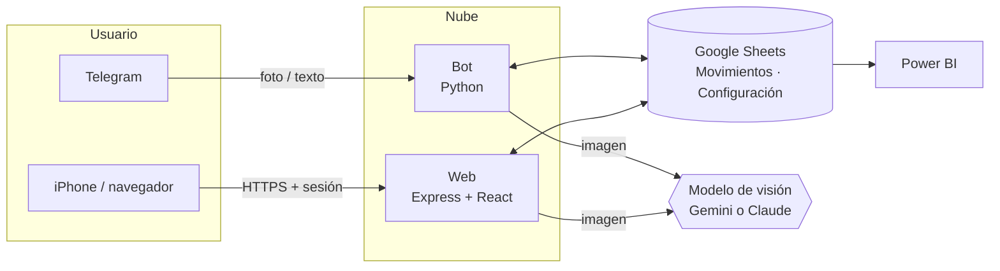

# Arquitectura — Vuelto

> Versión pública y resumida. El código fuente y la documentación operativa viven en repositorios privados.

## Resumen
Dos clientes (un bot de Telegram y una app web) escriben y leen en una misma hoja de Google Sheets, que actúa como
base de datos y como origen para Power BI. Ambos servicios se despliegan en la nube con despliegue continuo desde `main`.
La lectura de comprobantes se hace con un modelo de visión (Gemini por defecto).

## Diagrama


## Componentes
| Componente | Stack | Despliegue |
|-----------|-------|------------|
| Bot | Python 3.12, `python-telegram-bot`, `gspread`, `httpx` | Contenedor Docker con despliegue continuo desde `main` |
| Web | React 19, Vite, Tailwind CSS v4, `motion`, `lucide-react`; servidor Express 5 | Contenedor Docker multi-etapa con despliegue continuo desde `main` |
| Datos | Google Sheets (una pestaña de movimientos y otra de configuración) | — |
| Lectura de imágenes | Gemini (respuesta JSON estructurada) con modelos en cascada; Claude como alternativa en el bot | APIs externas |

## Estructura de la app web
```
web/
├── server.js            # API, sesión, Google Sheets, lectura de vouchers y estáticos
├── src/
│   ├── App.jsx          # pestañas: inicio, movimientos, recurrentes, presupuesto
│   ├── components/      # Dashboard, QuickAdd, TransactionEditor, BudgetScreen, ...
│   └── lib/             # parsers, clasificador, presupuesto, recurrentes
├── public/              # ícono para iPhone
└── Dockerfile
```

## Modelo de datos — pestaña `Movimientos`
| ID | Fecha | Hora | Tipo | Monto | Moneda | Comercio | Categoria | Medio de pago | Nota | Origen | Registrado |
|----|-------|------|------|-------|--------|----------|-----------|---------------|------|--------|------------|

- `Monto` siempre positivo; el signo lo da `Tipo` (`gasto` / `ingreso`).
- `Fecha` y `Monto` se escriben tipados para que Power BI no necesite conversiones.
- `Origen` indica si el movimiento vino del bot (foto o texto) o de la web.

## API de la web
API REST bajo `/api/*`, protegida por sesión: CRUD de movimientos, lectura de vouchers (la imagen se comprime en el
navegador antes de enviarse) y sincronización de presupuestos, recurrentes y reglas.

## Seguridad y privacidad (principios)
- Las credenciales de Google y las claves de API viven solo en el servidor, como variables de entorno; nunca llegan al navegador ni a git.
- El bot solo responde a usuarios autorizados.
- La web exige contraseña, usa sesión firmada y limita los intentos de acceso.
- Los datos financieros reales nunca se publican: las capturas usan una hoja de demostración con datos ficticios.

## Decisiones técnicas
Ver [`decisiones/`](decisiones/).
