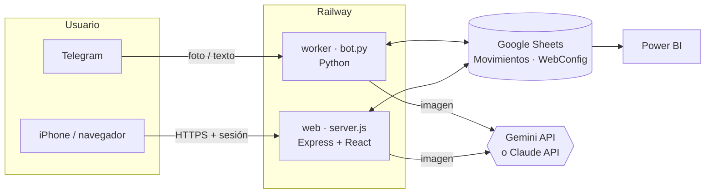

# Arquitectura — Vuelto

> Código fuente en dos repositorios privados: `Vuelto-web.io` (app web) y `MyFinanzas.io` (bot de Telegram).

## Resumen
Dos clientes (un bot de Telegram y una app web) escriben y leen en una misma hoja de Google Sheets, que actúa como
base de datos y como origen para Power BI. Ambos servicios corren en el mismo proyecto de Railway y comparten variables.
La lectura de comprobantes se hace con un modelo de visión (Gemini por defecto).

## Diagrama


## Componentes
| Componente | Stack | Ubicación | Despliegue |
|-----------|-------|-----------|------------|
| Bot | Python 3.12, `python-telegram-bot`, `gspread`, `httpx` | repo privado `MyFinanzas.io` | Railway, servicio `worker`: despliegue automático al hacer push a `main` |
| Web | React 19, Vite, Tailwind CSS v4, `motion`, `lucide-react`; servidor Express 5 + `google-auth-library` | repo privado `Vuelto-web.io` | Railway, servicio `Vuelto-web.io`: despliegue automático al hacer push a `main` (Docker multi-etapa) |
| Datos | Google Sheets (pestañas `Movimientos` y `WebConfig`) | cuenta de Google del PO | — |
| Lectura de imágenes | Gemini (`generateContent`, respuesta JSON) con modelos en cascada; Claude opcional en el bot | APIs externas | — |

## Estructura del repositorio `Vuelto-web.io`
```
vuelto-web/
├── server.js            # API, sesión, Google Sheets, lectura de vouchers y estáticos
├── index.html
├── src/
│   ├── App.jsx          # pestañas: inicio, movimientos, recurrentes, presupuesto
│   ├── components/      # Dashboard, QuickAdd, TransactionEditor, BudgetScreen, ...
│   └── lib/             # store, remote, parsers, clasificador, presupuesto, recurrentes
├── public/              # ícono para iPhone
├── SPEC.md              # especificación funcional inicial (Sprint 3)
├── Dockerfile
└── docs/                # gestión Scrum del producto
```

## Modelo de datos — pestaña `Movimientos`
| ID | Fecha | Hora | Tipo | Monto | Moneda | Comercio | Categoria | Medio de pago | Nota | Origen | Registrado |
|----|-------|------|------|-------|--------|----------|-----------|---------------|------|--------|------------|

- `Monto` siempre positivo; el signo lo da `Tipo` (`gasto` / `ingreso`).
- `Fecha` y `Monto` se escriben tipados para que Power BI no necesite conversiones.
- `Origen`: `foto` o `texto` cuando viene del bot; `web-<fuente>` cuando viene de la web.

## API de la web
| Método | Ruta | Uso |
|--------|------|-----|
| POST | `/api/login` · `/api/logout` | Sesión con cookie firmada (HMAC), 60 días; 5 intentos fallidos → bloqueo de 5 min por IP |
| GET | `/api/state` | Movimientos + configuración |
| GET/POST/PUT/DELETE | `/api/movimientos[/:id]` | CRUD sobre la hoja |
| POST | `/api/leer-voucher` | Imagen comprimida (≤1600 px) → borrador |
| PUT | `/api/config` | Presupuestos, recurrentes y reglas → `WebConfig` |
| GET | `/healthz` | Health check |

## Ejecutar en local
Ver la guía de instalación de cada repositorio privado.

## Variables de entorno
| Variable | Servicio | Para qué |
|----------|----------|----------|
| `TELEGRAM_BOT_TOKEN` | bot | Token de @BotFather |
| `ALLOWED_USER_IDS` | bot | IDs de Telegram autorizados |
| `SHEET_ID` | ambos | Hoja de Google |
| `GOOGLE_CREDENTIALS_JSON` / `GOOGLE_CREDENTIALS_FILE` | ambos | Cuenta de servicio |
| `EXTRACTOR`, `GEMINI_API_KEY`, `GEMINI_MODEL` | ambos | Lectura de imágenes |
| `ANTHROPIC_API_KEY`, `CLAUDE_MODEL` | bot (opcional) | Lector alternativo |
| `TIMEZONE` | bot | `America/Lima` |
| `APP_PASSWORD`, `SESSION_SECRET` (opcional) | web | Acceso a la web |
> En Railway la web toma las variables del bot con `${{worker.VARIABLE}}`. Los valores reales nunca van a git.

## Decisiones técnicas
Ver [`decisiones/`](decisiones/).
